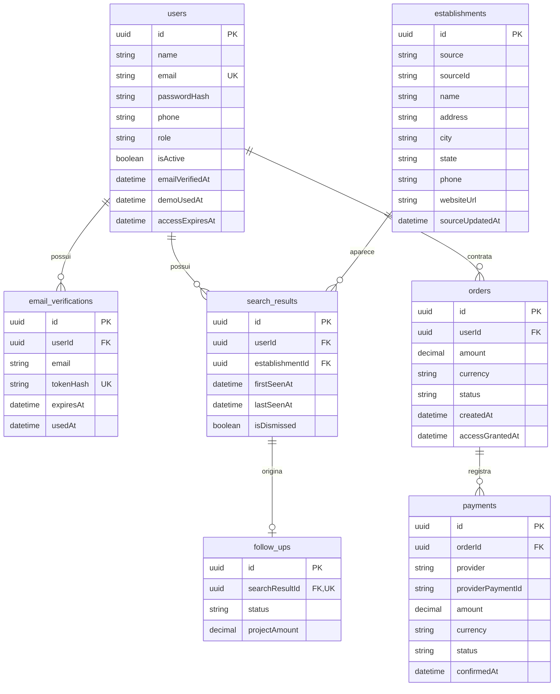

# 🛠️ Architecture / Software Design Document

**Projeto:** Radar Local
**Versão:** 1.0 · entrevista consolidada para leitura do aluno
**Última atualização:** 2026-10-29

Este documento define onde as coisas moram e como se chamam. O comportamento
continua no PRD; DTOs específicos, telas e estados nascem na spec de cada história.
Na Atividade 08, o setup gera somente a fundação, sem regras de negócio.

## 🤖 1. Fontes de Contexto para a IA

| Fonte | Onde consultar | Serve para |
| :--- | :--- | :--- |
| Constituição | `.agents/rules/utf-rules.md`, via `AGENTS.md` | Fases do SDD, aprovação, TDD, revisão e Git |
| Fluxos e subagentes | `.agents/workflows/` e `.agents/agents/` | Entrevistas, setup, execução e tutor |
| Produto | `docs/prd.md` | Glossário, atores, histórias e regras |
| Jornada | `docs/user-flows.md` | Pagamento independente da presença do usuário |
| Design | `docs/design-tokens.md` e o [Figma](https://www.figma.com/design/1CkMDJeQzb7jj7eLUlTgII/Radar-Local) | Tokens e protótipo |
| Disciplina | `docs/checklist.md` | Stack fixa, indicadores e entregas |
| Ferramentas | Documentação oficial referenciada aqui; Context7 quando disponível | Conferir padrões e compatibilidade |

Context7 não estava disponível nesta sessão. As consultas usaram documentação
oficial. Instalar o MCP globalmente permanece tarefa de ambiente; este documento
não configura ferramentas nem registra credenciais.

## 📦 2. Stack Tecnológica

As linhas representam versões principais, sem atualização automática de major.
Versões exatas e dependências transitivas ficarão nos manifestos e lockfiles,
criados no setup. Nenhuma dependência direta entra sem declaração aqui.

| Peça | Linha | Motivo |
| :--- | :--- | :--- |
| Runtime | Node.js 24.x e npm 11.x | Aproveitar o ambiente instalado; conferir mínimos no setup |
| Linguagem | TypeScript 6.x | Tipagem nos dois apps e compatibilidade com o gerador NestJS 12 |
| Backend | NestJS 12.x | Stack fixa; projeto ESM para o Vitest escolhido |
| ORM | Prisma ORM 7.x | Linha estável suportada; Prisma 8 ainda em release candidate na consulta |
| Banco | PostgreSQL 16.x | Banco local em Docker conforme a Atividade 08; mesmo major previsto no CI e na produção |
| Frontend | Vue 3.x | Escolhido pelo aluno pela facilidade inicial, sem experiência prévia nos frameworks |
| Build web | Vite 8.x | Servidor de desenvolvimento e build |
| Navegação | Vue Router 5.x | Biblioteca oficial; carregamento por rota |
| Estilo | CSS puro | Seguir os tokens sem biblioteca de estilos ou componentes |
| Testes | Vitest 5.x em ambos | Uma ferramenta para aprender e operar |
| Lint API | oxlint | Manter o padrão do gerador oficial NestJS 12 |
| Lint web | ESLint 10.x | Verificar TypeScript e Vue |
| Banco em nuvem | Neon, São Paulo | Provedor permitido pela ficha |
| Estabelecimentos | Geoapify Places API v2 e Place Details API v2 | Busca e armazenamento do histórico com atribuição |
| Pagamento | Mercado Pago Checkout Pro | Compra avulsa e confirmação por webhook em ambiente de testes |
| E-mail | Resend API | Confirmação pelo backend; domínio verificado para usuários reais |

Os provedores externos serão acessados por adaptadores no backend com `fetch`
nativo, sem SDK obrigatório. O contrato REST do Checkout Pro será conferido na
spec de US08, sem misturar as opções Orders e Preferences do provedor.

### Dependências auxiliares previstas

As linhas compatíveis destes pacotes serão conferidas, propostas ao aluno e
registradas antes da instalação no setup ou na história que os introduzir.
Esta lista declara finalidade e pacote, sem autorizar bibliotecas adicionais.

| Grupo | Pacotes | Finalidade |
| :--- | :--- | :--- |
| Runtime NestJS | `@nestjs/common`, `@nestjs/core`, `@nestjs/platform-express`, `reflect-metadata`, `rxjs` | Servidor HTTP e infraestrutura do framework |
| Configuração e contrato | `@nestjs/config`, `@nestjs/jwt`, `@nestjs/swagger` | Ambiente, JWT e OpenAPI |
| Validação | `class-validator`, `class-transformer` | DTOs e ValidationPipe |
| Prisma 7 | `prisma`, `@prisma/client`, `@prisma/adapter-pg`, `pg`, `dotenv` | CLI, cliente, driver e ambiente da CLI |
| Build e tipos | `@nestjs/cli`, `@nestjs/schematics`, `@vitejs/plugin-vue`, `vue-tsc`, `@vue/tsconfig`, `@types/node`, `@types/express`, `@types/pg` | Geração, compilação e tipos |
| Testes | `@nestjs/testing`, `@vue/test-utils`, `jsdom`, `supertest`, `@types/supertest` | Módulos NestJS, componentes Vue, DOM e chamadas HTTP |
| Lint API | `oxlint` | Lint padrão do NestJS 12 |
| Lint web | `@eslint/js`, `typescript-eslint`, `eslint-plugin-vue`, `vue-eslint-parser`, `globals` | ESLint para TypeScript e Vue |

### Ratificações do setup — Atividade 08

- Geradores oficiais: `@nestjs/cli` 12.0.11 e `create-vue` 3.24.0, compatíveis com Node.js 24.21.0.
- API em ESM, com Vitest e oxlint; frontend também em ESM.
- Vitest 5.x nos dois apps e `@vitest/coverage-v8` 5.x na API; os geradores emitiram Vitest 4.x, ajustado à linha já declarada neste documento.
- oxlint 1.x nos dois apps, `oxlint-tsgolint` 7.x para análise de tipos da API e ESLint 10.x complementar no frontend.
- API: `prettier` 3.x e `source-map-support` 0.5.x, auxiliares padrão para formatação e rastreamento de erros.
- Web: `@tsconfig/node24` 24.x e `@types/jsdom` 30.x, configurações e tipos do ambiente de desenvolvimento e testes.
- Web: `@vitest/eslint-plugin` 1.x, `@vue/eslint-config-typescript` 14.x, `eslint-plugin-oxlint` 1.x e `jiti` 2.x, integração do lint gerada pelo Vue.
- Web: `npm-run-all2` 9.x e `vite-plugin-vue-devtools` 8.x, execução de scripts e inspeção local do Vue.
- Prisma CLI, cliente e adaptador PostgreSQL 7.10.x; driver `pg` 8.x, `dotenv` 17.x e `@nestjs/config` 12.x para carregar o ambiente dos dois programas.
- Não instalar `@nestjs/mau`, nem manter o script `deploy` emitido pelo Nest: deploy pertence à Atividade 15.
- Nenhuma instalação ou configuração do NestJS Observe; o arquivo promocional `apps/api/AGENTS.md` emitido pelo CLI foi removido.

Dependência direta adicional emitida por gerador precisa ser justificada e
registrada antes de permanecer no projeto. Não instalar ferramentas só porque
são oferecidas pelo gerador.

Fontes: [NestJS 12](https://docs.nestjs.com/migration-guide),
[Prisma 7 versus 8](https://www.prisma.io/docs/orm/release-status),
[bancos Prisma 7](https://docs.prisma.io/docs/orm/v7/reference/supported-databases),
[Vue e TypeScript](https://vuejs.org/guide/typescript/overview.html),
[Vite 8](https://v8.vite.dev/blog/announcing-vite8),
[Vue Router 5](https://router.vuejs.org/guide/migration/v4-to-v5.html),
[Vitest 5](https://vitest.dev/blog/vitest-5),
[ESLint 10](https://eslint.org/blog/2026/02/eslint-v10.0.0-released/).

### 🧱 2.1. Backend — regras estruturais

- **Camadas — ID6/ID8:** módulos por domínio. Controller recebe dados validados
  e chama Service. Service aplica regras e acessa o banco pelo PrismaService
  injetado. Controller nunca consulta Prisma. Module conecta providers, sem
  lógica de negócio. Modelos ORM não são contratos HTTP.
- **Entrada — ID7:** DTOs de classe com `class-validator` e `class-transformer`.
  ValidationPipe global com `whitelist: true`, `forbidNonWhitelisted: true` e
  transformação explícita segundo os tipos. Mapear campos permitidos antes de
  persistir; papel e concessão de acesso são determinados pelo servidor.
- **Autenticação — ID9:** JWT com `@nestjs/jwt` e Guard nas operações privadas.
  Guard de papéis `DEVELOPER` e `ADMIN`. Verificar conta ativa e, quando aplicável,
  confirmação de e-mail, acesso válido e propriedade no servidor.
- **Privacidade — RNF01:** consultas de histórico e acompanhamento delimitadas
  pelo proprietário autenticado, nunca por um proprietário informado pelo cliente.
  ADMIN não possui acesso universal: não consulta prospecção privada.
- **Sessão — adiado para US03:** transporte e armazenamento do JWT, duração,
  logout e eventual revogação serão aprovados na spec antes de implementar.
  Devem cumprir logout e bloqueio de conta desativada previstos no PRD.
- **Senhas e tokens:** guardar hashes, sem texto original. Proposta técnica para
  ratificação na leitura: `node:crypto`, com `scrypt` e salt para senhas, geração
  aleatória e hash para confirmação, evitando biblioteca extra. Parâmetros e
  testes pertencem às specs US01/US02.
- **Respostas — ID10:** interceptor global com `data` no sucesso e metadados
  quando necessários; preservar respostas sem corpo. Exception Filter global
  com `statusCode`, `code`, `message` e detalhes seguros de validação. Preservar
  status HTTP, sem expor stack, SQL ou segredos. Lista vazia é sucesso; falha
  no provedor é erro. Formato proposto para ratificação na leitura integral.
- **Configuração — ID17:** ConfigModule lê o ambiente e valida variáveis
  obrigatórias no início. `.env` ignorado pelo Git; exemplos com valores vazios.
  CI/produção injetam segredos pela plataforma. Variáveis `VITE_*` são públicas.
- **Geoapify:** adaptador em `integrations/geoapify`, chave apenas no backend.
  Normalizar para o modelo interno, guardar apenas campos necessários e cumprir
  atribuição Geoapify/OpenStreetMap e obrigações ODbL aplicáveis. Não armazenar
  resposta bruta completa. Classificação de URLs pertence à spec US04: rede
  social não comprova site próprio; campo ausente não comprova inexistência.
- **Pagamento — ID20/ID21:** adaptador em `integrations/mercado-pago`. Pedido e
  preço definidos no servidor. Verificar assinatura do webhook e consultar o
  pagamento autenticado no provedor; conferir pedido, valor, moeda e recebedor.
  Transação e controle atômico por pedido impedem dupla concessão, inclusive em
  concorrência e múltiplas tentativas. Retorno do checkout não confirma pagamento.
  Usar contas/cartões de teste na demonstração. Não guardar dados de cartão nem
  implementar renovação automática.
- **E-mail:** adaptador em `integrations/resend`; confirmação de uso único
  associada ao endereço confirmado. Remetente com domínio verificado em produção.
  Testes simulam os provedores, sem mensagens, consultas ou cobranças reais.
- **Qualidade — ID11/ID12/ID18:** TDD; testar sucesso, erro, isolamento entre
  contas e idempotência. Integração com banco de testes separado. Futuro CI
  GitHub Actions executará testes, tipos e lint antes do merge; sem criar pipeline
  nesta atividade.

Referências: [validação](https://docs.nestjs.com/techniques/validation),
[autenticação](https://docs.nestjs.com/security/authentication),
[autorização](https://docs.nestjs.com/security/authorization),
[interceptors](https://docs.nestjs.com/interceptors),
[filters](https://docs.nestjs.com/exception-filters),
[Geoapify: armazenamento](https://www.geoapify.com/places-api/),
[Geoapify: termos](https://www.geoapify.com/terms-and-conditions/),
[Checkout Pro](https://www.mercadopago.com.br/developers/pt/docs/checkout-pro-orders/overview),
[notificações](https://www.mercadopago.com.br/developers/pt/docs/checkout-pro-orders/notifications),
[Resend](https://resend.com/docs/send-with-nodejs).

### 🌐 2.2. O contrato da API

Swagger/OpenAPI gerado do código com `@nestjs/swagger`, servido pela API em
`/docs`, documento JSON vivo em `/docs-json`. Serviços do frontend derivam seus
contratos dessa fonte e adaptam tipos externos para os modelos das telas.
Não manter tabela manual de endpoints nem commitar `swagger.json`.

Referência: [OpenAPI no NestJS](https://docs.nestjs.com/openapi/introduction).

### 🧪 2.3. Comandos de qualidade previstos

Executados da raiz após o setup, localmente e no CI:

| Verificação | Comando |
| :--- | :--- |
| Testes API | `npm run test -w apps/api` |
| Testes HTTP/banco API | `npm run test:e2e -w apps/api` |
| Testes web | `npm run test -w apps/web` |
| Lint API | `npm run lint -w apps/api` |
| Lint web | `npm run lint -w apps/web` |
| Tipos API | `npm run typecheck -w apps/api` |
| Tipos web | `npm run typecheck -w apps/web` |

Scripts `test` usam `vitest run`, sem watch. `test:e2e` seleciona testes HTTP/banco;
quando houver acesso a dados, usará DATABASE_URL de testes. O teste de demonstração
do setup não acessa banco. Lint sem `--fix`; tipos com `tsc --noEmit` na API e
`vue-tsc --build --noEmit` no web, cobrindo as referências de configuração e testes.
Na raiz, `npm test` encadeia os três comandos
de testes; `npm run lint`, os dois de lint; `npm run typecheck`, os dois de tipos,
sempre interrompendo na falha.

Na raiz, `start` executa `npm run start -w apps/api`, `api` executa
`npm run start:dev -w apps/api` e `web` executa `npm run dev -w apps/web`.
`build` encadeia `npm run build -w apps/api` e `npm run build -w apps/web`.

## 🗂️ 3. Estrutura do Repositório (Monorepo)

Cada app tem seu `package.json`; a raiz declara `"workspaces": ["apps/*"]`
e os scripts de orquestração com `-w`. Um único `package-lock.json`, na raiz,
registra as dependências de ambos. `npm install` na raiz instala todo o monorepo.
Somente npm, sem Nx ou Turborepo neste estágio, e sem `.git` dentro dos apps.

Arquivos do setup: `package.json` e `package-lock.json` na raiz, `.gitignore`,
`.gitattributes`, `docker-compose.yml` e `specs/README.md`.
Na API, `prisma.config.ts`, `prisma/schema.prisma`, `.env.example`,
`vitest.config.ts`, `vitest.config.e2e.ts`, `.oxlintrc.json` e `.prettierrc`.
O Prisma 7.10.1 gera `prisma7.config.ts`; o setup ajusta o nome para
`prisma.config.ts`, reconhecido pela CLI e exigido na atividade. As skills
adicionais instaladas pelo `prisma init` não fazem parte deste monorepo.
No web, configurações Vite/Vitest, ESLint/oxlint, TypeScript, `.editorconfig`
e sugestões de extensões em `.vscode/extensions.json`, conforme o gerador.
Arquivos e componentes de demonstração permanecem até as primeiras histórias;
não representam telas ou entidades do produto.

```text
.
├── .agents/                     # regras, workflows e subagentes existentes
├── .github/                     # templates e workflows
├── AGENTS.md                    # aponta às regras; não reescrever
├── README.md
├── docs/
├── specs/                       # spec e plano de cada história
└── apps/
    ├── api/
    │   ├── package.json
    │   ├── prisma/              # schema e migrations, pelas histórias
    │   ├── src/
    │   │   ├── common/          # guards, decorators, interceptor e filter
    │   │   ├── config/          # ambiente
    │   │   ├── database/        # PrismaModule e PrismaService
    │   │   ├── integrations/    # Geoapify, Mercado Pago e Resend
    │   │   └── modules/         # controller, service, module e dto por domínio
    │   └── test/                # testes HTTP/banco
    └── web/
        ├── package.json
        └── src/
            ├── app/             # inicialização e router
            ├── features/        # páginas, componentes, composables e serviços por domínio
            └── shared/          # HTTP, tipos, componentes e estilos/tokens comuns
```

Árvore de destino, sem criar pastas vazias. Setup gera somente a fundação;
entidades, domínios e migrations entram por histórias com spec aprovada.
Testes unitários próximos do arquivo testado.

## 🏗️ 4. Arquitetura Frontend

Composition API, `<script setup lang="ts">`, `ref`/`computed`, props e emits
tipados. Páginas separadas de componentes reutilizáveis. Vue Router com imports
dinâmicos por rota; rotas concretas nas specs. CSS puro traduz os tokens de
`docs/design-tokens.md` em variáveis. Dados e código em inglês; UI em português.

Dependência: página/componente → composable → serviço da feature → cliente HTTP
compartilhado → API. Componentes não chamam `fetch`. O cliente usa `fetch` nativo
e centraliza autenticação e erros; serviços adaptam contratos. Mudança da
representação externa se resolve nessa camada; mudança visível de comportamento
pode exigir ajuste de tela.

Estado da UI separado dos dados do servidor. Composables representam carregando,
erro, vazio e sucesso, evitando reenvio pendente. Sem biblioteca extra de estado
ou HTTP. Restrições visuais não substituem autorização no backend.

Referências: [Composition API](https://vuejs.org/guide/introduction),
[composables](https://vuejs.org/guide/reusability/composables.html),
[lazy loading](https://router.vuejs.org/guide/advanced/lazy-loading.html).

## 🗄️ 5. Arquitetura de Dados

### 📖 5.1. Glossário Técnico (Mapeamento)

Tabelas no plural em `snake_case`; modelos Prisma singulares em PascalCase com
`@@map`. Atributos e colunas em camelCase. IDs internos UUID; IDs externos strings
separadas. Datas em UTC. Valores monetários Decimal, nunca ponto flutuante; moeda
explícita na cobrança. Campos opcionais anuláveis. Enumerações detalhadas nas specs.

| Termo PRD | Modelo Prisma / tabela | Atributos principais |
| :--- | :--- | :--- |
| Desenvolvedor e administrador (usuário) | `User` / `users` | `id`, `name`, `email`, `passwordHash`, `phone`, `role`, `isActive`, `emailVerifiedAt`, `demoUsedAt`, `accessExpiresAt` |
| Confirmação de e-mail | `EmailVerification` / `email_verifications` | `id`, `userId`, `email`, `tokenHash`, `expiresAt`, `usedAt` |
| Estabelecimento | `Establishment` / `establishments` | `id`, `source`, `sourceId`, `name`, `address`, `city`, `state`, `phone`, `websiteUrl`, `sourceUpdatedAt` |
| Histórico de resultados | `SearchResult` / `search_results` | `id`, `userId`, `establishmentId`, `firstSeenAt`, `lastSeenAt`, `isDismissed` |
| Acompanhamento | `FollowUp` / `follow_ups` | `id`, `searchResultId`, `status`, `projectAmount` |
| Pedido | `Order` / `orders` | `id`, `userId`, `amount`, `currency`, `status`, `createdAt`, `accessGrantedAt` |
| Pagamento | `Payment` / `payments` | `id`, `orderId`, `provider`, `providerPaymentId`, `amount`, `currency`, `status`, `confirmedAt` |

`sourceUpdatedAt` é a data de atualização da cópia local, sem prometer verificação
real do negócio. Dados públicos de estabelecimento podem ser compartilhados;
histórico, desinteresse, status e valor são privados por usuário.

Termos sem tabela própria:

- **Possível cliente:** classificação de estabelecimento segundo a fonte.
- **Sem interesse:** `isDismissed` no histórico privado.
- **Demonstração:** consumo em `users.demoUsedAt`.
- **Plano de acesso:** produto único; validade em `accessExpiresAt` e concessão
  rastreada no pedido. Sem catálogo de planos ou assinatura recorrente.
- **Busca:** operação, sem guardar cada requisição; histórico preserva os negócios
  apresentados, sem duplicá-los por usuário.
- **Projeto aceito/finalizado:** status e valor no acompanhamento; não é pedido
  nem pagamento do Radar Local. Sem entidade de proposta ou projeto separado.

### 📊 5.2. Diagrama ER (Mermaid)



Unicidades compostas: `establishments(source, sourceId)`,
`search_results(userId, establishmentId)` e `payments(provider, providerPaymentId)`
quando existir ID externo. Um acompanhamento por resultado no histórico; o
proprietário vem desse vínculo, sem duplicá-lo. Cada pedido aceita várias
cobranças/tentativas, mas concede acesso uma vez. Usar `accessGrantedAt` com
transação e atualização condicional; unicidade do pagamento sozinha não basta.

### 🌍 5.3. O banco por ambiente

| Ambiente | Onde roda | Como conecta |
| :--- | :--- | :--- |
| Local | PostgreSQL 16.x em Docker; banco de testes separado quando necessário | `DATABASE_URL` no `.env` ignorado; testes apontam para o banco de testes |
| CI | PostgreSQL 16.x em container no GitHub Actions | `DATABASE_URL` e credenciais efêmeras injetadas pelo workflow, sem valores versionados |
| Produção | PostgreSQL 16.x no Neon, São Paulo | `DATABASE_URL` nos secrets da hospedagem; pooling para a aplicação |

Docker local na Atividade 08; nuvem no deploy. Não provisionar agora. Se migrations
exigirem conexão separada, usar `DIRECT_URL`, com valor somente no ambiente.
Migrations versionadas serão a fonte das alterações de schema pelas histórias.

No setup, `docker-compose.yml` usa `postgres:16`, volume persistente e publicação
somente em `127.0.0.1:5433`, pois a porta 5432 já está ocupada por outro projeto.
O `.env` da API acompanha a porta 5433; o schema nasce sem modelos e sem migrations.

Referências: [Neon: versões](https://neon.com/docs/reference/compatibility),
[regiões](https://neon.com/docs/introduction/regions).

### 5.4. Integrações e decisões pendentes

Geoapify escolhida após amostra do aluno em Guarapuava–PR: 20 resultados, dez
telefones e dois campos de site, um Instagram. Comprova retorno local, sem
comprovar cobertura completa ou atualização. PRD ajustado com aprovação do aluno;
link de navegação ao Google Maps não o torna fonte dos dados.

Variáveis previstas, sem valores: `DATABASE_URL`, `DIRECT_URL` quando necessária,
`JWT_SECRET`, `GEOAPIFY_API_KEY`, `MERCADO_PAGO_ACCESS_TOKEN`,
`MERCADO_PAGO_WEBHOOK_SECRET`, `RESEND_API_KEY`, `EMAIL_FROM`, `WEB_URL`,
`CORS_ORIGIN` e `VITE_API_URL`. Só a última é configuração pública do web.

| Decisão adiada | Quando resolver |
| :--- | :--- |
| Preço, cotas, unidade de consumo e efeitos de filtros/falhas | PRD §9, antes de busca/contratação; dimensionar Places e Place Details |
| Prazo de expiração do pedido e suporte para confirmação ausente | Spec US08; sair da página não cancela pedido |
| Transporte, duração e encerramento da sessão JWT | Spec US03, antes do login/logout |
| Redefinição administrativa de senha | PRD §9, antes da gestão de usuários |
| Domínio remetente e DNS no Resend | Antes do envio para usuários reais; domínio de teste tem destinatários restritos |
| Hospedagem da API e web | Deploy; avaliar proximidade do banco Neon |

Detalhes auxiliares propostos neste documento precisam de ratificação na leitura
integral. Qualquer mudança de stack ou entidades exige atualização explícita aqui.

## 🗺️ 6. Mapa de Domínios

Índice reservado; cresce a partir da primeira história implementada.

| Domínio | Módulo (pasta) | Guard | Dados (repository) | US |
| :--- | :--- | :--- | :--- | :--- |

## 📅 7. Histórico

Reservado para evolução após esta atividade.

| Data | Versão | O que mudou |
| :--- | :--- | :--- |
