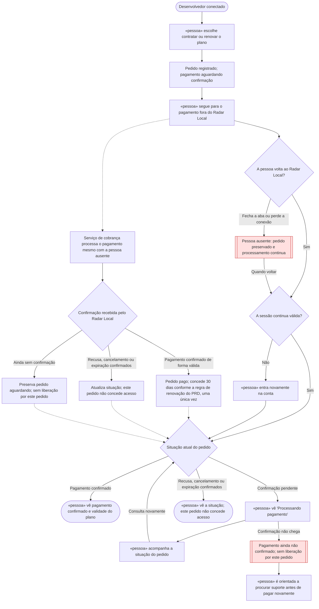

# 🗺️ Jornadas de Usuário

**Projeto:** Radar Local
**Versão:** 1.0.0 · jornada aprovada na entrevista, aguardando leitura integral e commit do aluno
**Última atualização:** 2026-10-21

> Este documento descreve o caminho vivido pelo usuário e os pontos em que ele
> espera ou abandona o processo. Regras de negócio permanecem no `prd.md`;
> a estrutura técnica será definida no `architecture.md`.

## Jornada 1 — Contratar ou renovar o plano de 30 dias

**Story:** US08 — Contratar e renovar o plano de acesso, no [PRD](prd.md).

**Critérios que ela marca:**

| Critério | Como aparece nesta jornada |
| --- | --- |
| Sai do site e volta | O desenvolvedor segue para o pagamento e depois retorna ao Radar Local. |
| Depende do tempo | A confirmação pode chegar depois do retorno ou enquanto o usuário está ausente. |
| Depende de outra pessoa agir | Depende da atuação do serviço de cobrança para confirmar o resultado do pagamento. |
| Pode ser abandonada no meio | O desenvolvedor pode fechar a aba ou perder a conexão antes de voltar. |

**Ponto de partida:** desenvolvedor conectado que escolhe contratar ou renovar
seu plano. Preço e limites continuam pendentes no PRD; esta jornada não os define.

As linhas pontilhadas indicam o processamento e a atualização que independem da
presença do desenvolvedor. Voltar ao site, inclusive por uma tela que indique
sucesso, não comprova o pagamento. A liberação depende da confirmação válida do
serviço de cobrança, conforme o PRD. Um pedido pendente não remove dias de um
plano anterior que ainda esteja válido; apenas não concede novos dias.

**O que decidimos sobre o nó vermelho:**

O processo de pagamento deve continuar mesmo que o desenvolvedor feche a aba.
Quando voltar e fizer login, ele poderá visualizar o status do pedido. O acesso
por 30 dias só será liberado após a confirmação do serviço de pagamento,
independentemente de ele estar conectado. Enquanto essa confirmação não chegar,
o pedido continuará aguardando, sem ser cancelado apenas porque ele saiu.

O parágrafo acima foi organizado a partir da resposta do aluno e aprovado por
ele na entrevista.

**Demais situações discutidas e aprovadas:**

- **Conexão cai:** preservar o pedido e mostrar sua situação atual quando o
  desenvolvedor voltar, para que consulte o pedido existente antes de tentar
  pagar novamente.
- **Sessão expira:** exigir novo login para consultar o pedido; o processamento
  e a concessão dos dias após a confirmação continuam independentes da sessão.
- **Retorno indica sucesso antes da confirmação:** mostrar “Processando
  pagamento” e aguardar a confirmação do serviço de cobrança para conceder os dias.
- **Confirmação não chega:** mostrar “Pagamento ainda não confirmado”, sem
  conceder acesso por esse pedido, e orientar a procurar suporte antes de pagar
  novamente. Não foi definido um prazo automático para concluir que ela não chegou.
- **Renovação:** aplicar as regras do PRD: somar 30 dias à validade ainda ativa ou
  começar na confirmação se o plano estiver vencido; uma confirmação repetida
  não concede dias novamente.

## Dúvidas em aberto

| # | Dúvida | Onde ela precisa ser resolvida |
| --- | --- | --- |
| 1 | Preço e limites do plano permanecem pendentes, sem impedir o desenho da jornada. | PRD §9, antes de promover US08 a Ready. |
| 2 | Qual prazo ou condição permitirá considerar um pedido expirado, e como tratar a ausência prolongada de confirmação? Não há cancelamento automático por fechar a aba. | Decisão do aluno ao detalhar US08 e os estados na arquitetura, considerando o serviço de cobrança escolhido. |
| 3 | Qual será o canal de suporte e como o administrador verificará um pagamento não confirmado antes de orientar nova tentativa? | Decisão do aluno antes da implementação da jornada. |
